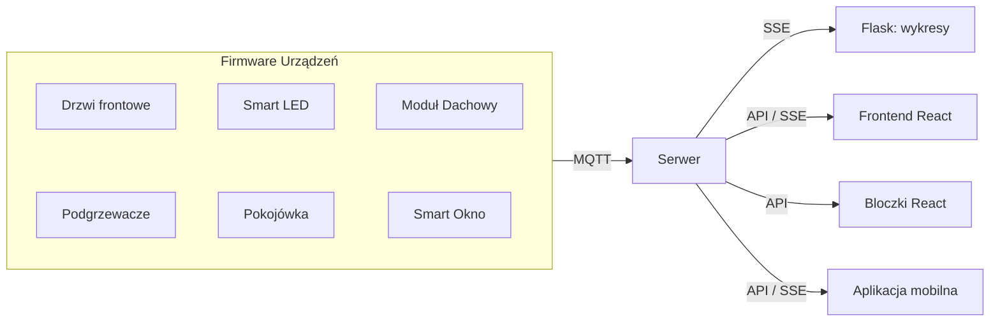

# Smart Home Assistant "Pokojówka"

To nasza implementacja asystenta domowego.
 
Implementujemy dostęp do różnych urządzeń wykonawczych oraz pobierających dane.
 
Dane wspomnianych urządzeń można wyświetlać oraz zarządzać poprzez stronę internetową oraz aplikację mobilną.

## O projekcie
- Realizowaliśmy ten projekt na podstawie projektu PBL Politechniki Śląskiej w latach 2025/2026
- Najważniejsze nowinki tego projektu to zarządzenia urządzeniami wykonawczymi m.in. zdalnie sterowanymi oknami
- Nasz projekt był testowany na podstawie miniaturowej makiety, lecz system jest uniwersalny, więc wprowadzając minimalne zmiany możemy rozszerzyć go o (przykładowo) sterowanie prawdziwym elektronicznie sterowanym oknem

## Architektura

Cała wymiana danych pomiędzy serwerem a urządzeniami przechodzi przez serwer MQTT.
 
Serwer wysyła dane do widoków frontendowych za pomocą prostych requestów HTTP lub za pomocą SSE.

## Struktura repozytorium
| Katalog            | Opis                                                                                                                                                                                                                                                                                                            | Technologie                 | Dokumentacja                           |
|--------------------|:----------------------------------------------------------------------------------------------------------------------------------------------------------------------------------------------------------------------------------------------------------------------------------------------------------------|-----------------------------|----------------------------------------|
| bloczki            | Strona służąca do obsługi/zmiany integracji IoT Event -> Action; Przykładowo, po kliknięciu programowalengo przycisku na aplikacji mobilnej, wszystkie okna się zamkną                                                                                                                                          | React, ReactFlow            | [README](bloczki/README.md)            |
| firmware/door      | Oprogramowanie przystosowane dla Raspberry Pi Pico oraz ESP32, które zarządza silnikiem servo sterującym drzwiami frontowymi, oraz pobiera dane z czujnika ruchu                                                                                                                                                | MicroPython                 | [README](firmware/door/README.md)      |
| firmware/heater    | Oprogramowanie przystosowane dla Raspberry Pi Pico oraz ESP32, które zarządza elektronicznym podgrzewaczem                                                                                                                                                                                                      | MicroPython                 | [README](firmware/heater/README.md)    |
| firmware/ledzik    | Oprogramowanie przystosowane dla Raspberry Pi Pico oraz ESP32, które zarządza diodami led; Pojedynczą lub wieloma podłączonymi równolegle święcacymi w ten sam sposób                                                                                                                                           | MicroPython                 | [README](firmware/ledzik/README.md)    |
| firmware/pokojowka | Oprogramowanie przystosowane dla Raspberry Pi W (oraz wszystkich modeli kompatybilnych z Raspbianem); Pobiera ono dane temperatury, wilgotności, jakości powietrza oraz ciśnienia z czujnika                                                                                                                    | Python, Docker              | [README](firmware/pokojowka/README.md) |
| firmware/roof      | Oprogramowanie przystosowane dla Raspberry Pi Pico oraz ESP32, które pobiera dane z dwóch czujników; Pierwszy to czujnik światła, a drugi to czujnik opadów                                                                                                                                                     | CircuitPython               | [README](firmware/roof/README.md)      |
| firmware/window    | Oprogramowanie przystosowane dla Raspberry Pi Pico oraz ESP32, które zarządza silnikiem servo sterującym oknem                                                                                                                                                                                                  | MicroPython                 | [README](firmware/window/README.md)    |
| frontend           | Główny widok dla użytkownika w postaci strony internetowej. Pozwala ona wyświetlać oraz zarządzać wszystkimi urządzeniami w systemie                                                                                                                                                                            | Angular                     | [README](frontend/README.md)           |
| graphs             | Dodatkowy widok dla użytkownika dla wyświetlania danych urządzeń. Pozwala wyświetlać wykresy danych zmieniających się w czasie                                                                                                                                                                                  | Flask                       | [README](graphs/README.md)             |
| mobile             | Główny widok dla użytkownika w postaci aplikacji mobilnej. Pozwala ona wyświetlać oraz zarządzać wszystkimi urządzeniami w systemie. Dodatkowo daje ona dostęp do rozmowy z sztuczną inteligencją w postaci Chatu AI; Pozwala on zarządzać urządzeniami poprzez komendy tekstowe np. `Wyłącz wszystkie żarówki` | Jetpack Compose             | [README](mobile/README.md)             |
| server             | Serwer dla całego systemu. Korzystając z działającego serwera MQTT potrafi interpretować dane przesyłane przez ten serwer, odbierać requesty HTTP, oraz wysyłać dane w czasie rzeczywistym poprzez SSE                                                                                                          | Node.js, Typescript, Docker | [README](server/README.md)             |

## Wymagania
- Wszystkie programy można testować bez posiadania urządzeń typu RPi Pico
- Rekomendowane jest testowanie firmware'ow w /firmware na urządzeniach typu RPi Pico
- Oprogramowanie: Node.js, npm, Python, MicroPython, Docker, MQTT
- Dokładne wymagania znajdują się w dokumentacji konkretnej części projektu

## Komunikacja
HTTP - Serwer
Bazowy URL: `http://<host>:<port>`

<b>Root (/root)</b>

| Metoda | Endpoint         | Opis                                        |
|--------|------------------|---------------------------------------------|
| GET    | `/`              | Hello World                                 |
| GET    | `/notifications` | Zwraca wszystkie nowo stworzone notyfikacje |

<b>Devices (/devices)</b>

| Metoda | Endpoint       | Opis                                                                                      |
|--------|----------------|-------------------------------------------------------------------------------------------|
| GET    | `/online`      | Zwraca wszystkie urządzenia, które są aktualnie podłączone do serwera (bez legacy danych) |
| GET    | `/ids`         | Zwraca identyfikatory wszystkich urządzeń podłączonych do serwera                         |
| PUT    | `/:id/:name`   | Modyfikuje nazwę urządzenia o podanym identyfikatorze                                     |
| GET    | `/module-info` | Zwraca dane o wszystkich urządzeniach w skróconej formie - {id, type}                     |

<b>Devices Room (/devices/room)</b>

| Metoda | Endpoint | Opis                                                                |
|--------|----------|---------------------------------------------------------------------|
| GET    | `/`      | Zwraca dane o wszystkich urządzeniach typu: `room`, które są online |
| GET    | `/raw`   | Zwraca dane o wszystkich urządzeniach typu: `room`                  |

<b>Devices Window (/devices/window)</b>

| Metoda | Endpoint            | Opis                                                                  |
|--------|---------------------|-----------------------------------------------------------------------|
| GET    | `/`                 | Zwraca dane o wszystkich urządzeniach typu: `window`, które są online |
| GET    | `/raw`              | Zwraca dane o wszystkich urządzeniach typu: `window`                  |
| PUT    | `/:id/state/:state` | Modyfikuje stan okna o podanym id                                     |

<b>Devices Bulb (/devices/bulb)</b>

| Metoda | Endpoint                      | Opis                                                                |
|--------|-------------------------------|---------------------------------------------------------------------|
| GET    | `/`                           | Zwraca dane o wszystkich urządzeniach typu: `bulb`, które są online |
| GET    | `/raw`                        | Zwraca dane o wszystkich urządzeniach typu: `bulb`                  |
| PUT    | `/:id/state/:state`           | Modyfikuje stan żarówki o podanym id                                |
| PUT    | `/:id/brightness/:brightness` | Modyfikuje jasność żarówki o podanym id                             |

<b>Devices Heater (/devices/heater)</b>

| Metoda | Endpoint                      | Opis                                                                  |
|--------|-------------------------------|-----------------------------------------------------------------------|
| GET    | `/`                           | Zwraca dane o wszystkich urządzeniach typu: `heater`, które są online |
| GET    | `/raw`                        | Zwraca dane o wszystkich urządzeniach typu: `heater`                  |
| PUT    | `/:id/state/:state`           | Modyfikuje stan podgrzewacza o podanym id                             |
| PUT    | `/:id/temperature_goal/:temp` | Modyfikuje temperaturę celową podgrzewacza o podanym id               |

<b>Devices Roof (/devices/roof)</b>

| Metoda | Endpoint | Opis                                                   |
|--------|----------|--------------------------------------------------------|
| GET    | `/`      | Zwraca dane urządzeniu typu: `roof`, które jest online |
| GET    | `/:id`   | Zwraca dane o urządzeniu typu: `roof` o podanym id     |

<b>Devices Door (/devices/door) oraz Devices Home (/devices/home)</b>

| Metoda | Endpoint        | Opis                                                |
|--------|-----------------|-----------------------------------------------------|
| GET    | `/state/:state` | Modyfikuje dane wszystkich urządzeń o typie: `door` |

<b>Names (/names)</b>

| Metoda | Endpoint | Opis                                                    |
|--------|----------|---------------------------------------------------------|
| GET    | `/`      | Zwraca wszystkie zapisane pary id oraz nazwa urządzenia |

<b>Events (/)</b>

| Metoda | Endpoint         | Opis                                                             |
|--------|------------------|------------------------------------------------------------------|
| POST   | `/event/program` | Wywołuje funkcję programowalnego przycisku z aplikacji mobilnej  |
| GET    | `/action/all`    | Zwraca wszystkie integracje Event -> Action zapisane na serwerze |
| POST   | `/connections`   | Nadpisuje poprzednie integracje Event -> Action na serwerze      |

<b>Regsiter (/register)</b>

| Metoda | Endpoint | Opis                                         |
|--------|----------|----------------------------------------------|
| POST   | `/:type` | Nadaje nową nazwę urządzeniu o podanym typie |

<b>GPT (/gpt)</b>

| Metoda | Endpoint         | Opis                                                                                                                                                                       |
|--------|------------------|----------------------------------------------------------------------------------------------------------------------------------------------------------------------------|
| GET    | `/:msg`          | Przetwarza zapytanie przez API openai oraz zwraca odpowiedź                                                                                                                | 
| GET    | `/commands/:msg` | Przetwarza zapytanie przez API openai oraz zwraca odpowiedź z możliwością wykonania predefiniowanych działań typu: `Wyłącz wszystkie żarówki` -> Wyłącza wszystkie żarówki | 

<b>Streaming SSE (/stream)</b>

| Metoda | Endpoint            | Opis                                                                                                                       |
|--------|---------------------|----------------------------------------------------------------------------------------------------------------------------|
| GET    | `/activity`         | Tworzy połączenie typu SSE, które sprawdza ile urządzeń jest podłączonych do sieci (nawet wyłączonych telefonów)           | 
| GET    | `/activity/clients` | Zwraca ile jest podłączonych użytkowników do SSE /activity                                                                 |
| GET    | `/rooms`            | Tworzy połączenie typu SSE, które po odbiorze nowych danych urządzenia typu: `room` wyśle nowe dane do klientów            | 
| GET    | `/bulbs`            | Tworzy połączenie typu SSE, które po odbiorze nowych danych urządzenia typu: `bulb` wyśle nowe dane do klientów            | 
| GET    | `/windows`          | Tworzy połączenie typu SSE, które po odbiorze nowych danych urządzenia typu: `window` wyśle nowe dane do klientów          | 
| GET    | `/heaters`          | Tworzy połączenie typu SSE, które po odbiorze nowych danych urządzenia typu: `heater` wyśle nowe dane do klientów          | 
| GET    | `/notifications`    | Tworzy połączenie typu SSE, odbierające dane o nowych powiadomieniach                                                      |
| GET    | `/home`             | Tworzy połączenie typu SSE, które po odbiorze nowych danych urządzenia typu: `door` lub `roof` wyśle nowe dane do klientów | 

<b>Developer (/developer)</b>

| Metoda | Endpoint | Opis                   |
|--------|----------|------------------------|
| GET    | `/exit`  | Wyłącza proces serwera |

## Autorzy:
- Kamil Pogonowski
- Michał Wojtas
- Szymon Żelazny

